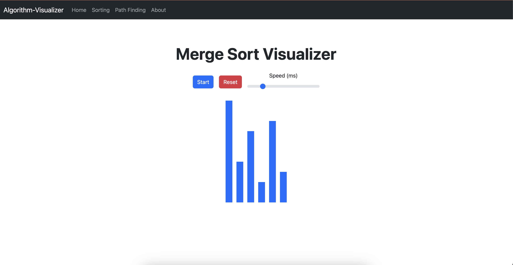

# Algorithm Visualiser - Web Assembly

A web-based algorithm visualiser built with [Leptos](https://leptos.dev/) and Rust. This project animates popular sorting algorithms step-by-step to help users understand how they work internally.

## 🖥️ Demo
https://hamamk.github.io/Rust-WASM-Algorithm-Visualiser/

---

## ✨ Features

- ✅ Visual step-by-step animation of sorting algorithms
- ⚡ Smooth transitions powered by reactive signals
- 🧠 Built using modern Rust + WASM (WebAssembly)
- 🎨 CSS styling via Bootstrap 
- 🔍 Logs internal sorting steps and UI updates (for debugging)

> ✅ Currently supports: **Merge Sort**

More algorithms like **Bubble Sort**, **Dijkstra's**, and others coming soon!

---

## ⚙️ Performance Highlights
### 🦀 Why Rust?
* Rust is renowned for its blazing-fast performance, memory safety, and zero-cost abstractions. In this project, Rust ensures:
* Fast computation of algorithm steps
* Safe concurrency with no data races
* Minimal runtime overhead

### 🌐 Why WebAssembly?
By compiling to WebAssembly, this visualiser:
* 🚀 Runs at near-native speed directly in the browser
* 🧩 Offers better performance than equivalent JavaScript visualisers
* 🔒 Operates in a secure, sandboxed environment

Combined, Rust + WASM make this tool lightweight, efficient, and perfectly suited for performance-intensive visualisations.

---

## 📸 Preview



---

## 🚀 Getting Started

### Prerequisites

- Rust (latest stable)
- Trunk or wasm-bindgen for WASM builds

### Installation

```bash
    # Clone the repo
    git clone https://github.com/hamaMk/Rust-WASM-Algorithm-Visualiser.git
    cd Rust-WASM-Algorithm-Visualiser
    
    # Run the app
    trunk serve
```


##  🛠️ Development 
### Notes
* Sorting animations are triggered reactively using Effect::new
* Visualisation is rendered using <For> loops with reactive styling
* Uses spawn_local and TimeoutFuture for step delays

### Release
```bash
    trunk build --release --config trunk-release.toml
```


## 👨‍💻 Author
Hamandishe Mkandabvute  
🔗 https://hamandishe.com
